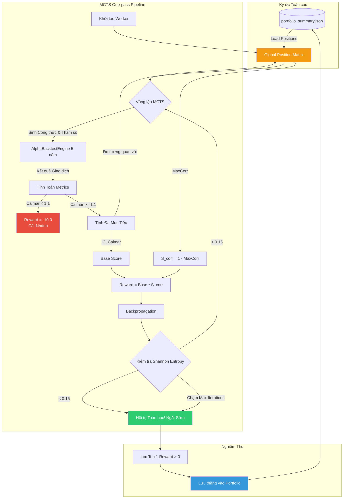

# Alpha Farm

Hệ thống tự động sinh, tối ưu hóa và thử nghiệm **tín hiệu giao dịch có hướng** (Directional Trading Signals) cho thị trường phái sinh VN30F.

### Câu hỏi nghiên cứu

> *Có thể kết hợp LLM (sinh cấu trúc chiến lược) với MCTS (tối ưu tham số) để tự động hóa việc khám phá các tín hiệu giao dịch có hướng trên hợp đồng tương lai đơn tài sản không?*

### Bản chất tín hiệu được sinh ra

Hệ thống sinh ra **Systematic Directional Signals** — tín hiệu dự đoán hướng đi tuyệt đối (Long/Short/Flat) trên một instrument duy nhất (VN30F), tương tự mô hình CTA/Managed Futures.

## 1. Kiến trúc Hệ thống (Dual Engine with Self-Correction)

Hệ thống được thiết kế theo mô hình khép kín gồm 2 động cơ độc lập (LLM Engine và MCTS Engine), được điều khiển tập trung qua `main.py`:

```mermaid
graph TD
    run_all(main.py<br>CLI Orchestrator)

    subgraph LLM_Engine ["Tầng 1: LLM Blueprint Generation"]
        run_all -->|1. python main.py generate| pipeline(GenerateStrategies.py)
        pipeline -->|Dịch & Validate Cú pháp| semantic_val[SemanticCompiler]
        semantic_val -->|Lỗi Cú Pháp / Ảo Giác| self_correct[Agentic Self-Correction]
        self_correct -->|Cập nhật JSON| pipeline
        semantic_val -->|Hợp lệ| save_json[Lưu Blueprint JSON]
    end

    subgraph MCTS_Engine ["Tầng 2 & 3: MCTS Brute-force & AlphaEngine"]
        run_all -->|2. python main.py mcts| mcts(RunMCTS.py)
        save_json -->|Load Blueprints| mcts
        mcts -->|Check Dimensional Bleeding & Compile (Multi-template)| mcts_sandbox[AlphaEngine]
        mcts_sandbox -->|Sử dụng AlphaPrimitives Tốc Độ Cao| hmm[3-Tier Realistic Validation <br> (Risk of Ruin/Kelly/Benchmark)]
        hmm -->|Pass 3 Tiers| save_success[Lưu Code Python vào results/]
    end

    style LLM_Engine stroke:#3498db,stroke-width:2px
    style MCTS_Engine stroke:#9b59b6,stroke-width:2px
```

Để xem thông tin kỹ thuật chuyên sâu về cấu trúc hệ thống, vui lòng tham khảo file `docs/ARCH.md`.

---

## 2. Hướng dẫn cài đặt và sử dụng

### Yêu cầu hệ thống

- Python 3.12 (Quản lý môi trường bằng `uv` để build các package C++ như `hmmlearn`).
- Ollama local (hoặc sử dụng các mô hình API Cloud).

### Cài đặt thư viện

Chạy lệnh sau để cài đặt toàn bộ các thư viện cần thiết:

```bash
uv pip install -r utilities/deps/deepseek4free/requirements.txt
uv pip install python-dotenv hmmlearn
```

### Cấu hình API & Tài khoản (.env)

- **Gemini**: Dán cookie lấy từ header vào file `cookies.txt` (nếu dùng mô hình Gemini).
- **DeepSeek**: Đăng nhập vào chat.deepseek.com, mở F12 (Network), sao chép giá trị của `Authorization` header và dán vào file `token.txt` ở thư mục gốc.

---

## 3. Khởi chạy hệ thống (CLI Commands)

Toàn bộ hệ thống nay được điều khiển thông qua một file duy nhất `main.py`. Bạn có thể sử dụng cờ `--help` để xem chi tiết:

```bash
python main.py --help
```

### Cách 1: Chạy Tự Động Toàn Tập (Nhạc Trưởng)

Dành cho việc cắm máy tự động chạy qua toàn bộ quy trình: Sinh ý tưởng (Generate) $\rightarrow$ Tìm kiếm thông số MCTS (MCTS).

```bash
python main.py full --n_strategies 20 --model deepseek-thinking
```

### Cách 2: Chạy Từng Động Cơ Độc Lập

Bạn hoàn toàn có thể chạy riêng từng phần tùy theo nhu cầu để dễ dàng debug và kiểm soát:

- **Săn Alpha bằng MCTS (Không cần AI):** Tự động dò tìm công thức toán học và đánh giá.
  ```bash
  python main.py mcts
  ```
- **Sinh Ý Tưởng bằng LLM (Deepseek/Gemini):** Dùng AI viết kịch bản giao dịch dạng khung cấu trúc (Blueprint JSON).
  ```bash
  python main.py generate --n_strategies 20 --model deepseek-thinking
  ```

---

## 4. Tinh chỉnh Sức mạnh (Tuning & Optimization)

### Tự sửa lỗi Inline (Agentic Self-Correction)

Quá trình tự sửa lỗi hiện tại đã được tích hợp trực tiếp **(Inline)** vào Tầng 1 (`GenerateStrategies.py`).
Ngay khi LLM sinh ra một Blueprint bị sai cú pháp hoặc sai thứ nguyên, `SemanticCompiler` sẽ ném lỗi và bắt LLM sửa ngay lập tức trong bộ nhớ.
Đặc biệt, hệ thống sử dụng **AlphaPrimitives** để mapping ngược các indicator cũ (`sma`, `boll`) thành các toán tử mới (`ts_mean`).

### MCTS Engine Tuning (`strategy_workflows/RunMCTS.py`)

MCTS Brute-force không chỉ tối ưu tham số mà còn tự động khám phá và xây dựng cây biểu thức toán học (AST).

- **Window Size & Z-Score Threshold**: MCTS sẽ tự động tìm kiếm chu kỳ làm mượt (`window`) và ngưỡng kích hoạt tương thích nhất thông qua cơ chế **Scale-Mismatch Dynamic Tuning** dựa trên timeframe.
- **3-Tier Realistic Validation (Bộ lọc 3 Tầng Thực tế)**: Backtest lịch sử không bao giờ là đủ. MCTS tích hợp bộ kiểm định 3 tầng khắt khe:
  1. **Tier 1 (Empirical Risk of Ruin)**: Dùng Hidden Markov Model (HMM) để giả lập 500 kịch bản giá ngẫu nhiên (Monte Carlo Paths) bao gồm cả những cú sốc thị trường. 
  2. **Tier 2 (Xác suất & Chi phí)**: Đảm bảo phân số Kelly (Kelly Fraction) > 0 và Tỉ lệ bao phủ chi phí (Cost Coverage Ratio) >= 3x.
  3. **Tier 3 (Benchmark Đời thực)**: Chiến lược phải đánh bại Lãi suất tiết kiệm không rủi ro (6%/năm) và chỉ số Sharpe của chiến lược Buy & Hold VN30 thụ động.

---

## 5. Cơ chế chấm điểm và Hội tụ nội bộ của MCTS (One-pass Pipeline)



**`Reward = (0.6 * S_calmar + 0.4 * S_ic) * S_corr`**

Hệ thống sử dụng hai cơ chế ngắt vòng lặp sớm để tiết kiệm tài nguyên: **Shannon Entropy** và **Patience**. Khi duyệt cây tìm kiếm (UCT), MCTS sử dụng **Điểm lớn nhất (Max Reward)** để tìm ra các chuỗi tham số "đột biến".

---

## 6. Động Cơ Lõi Vectorized & Chống Rò Rỉ Dữ Liệu (Core Engine)

Hệ thống sở hữu một động cơ giả lập siêu tốc (`AlphaBacktestEngine`) được thiết kế đặc trị chuẩn mực cho thị trường Phái sinh VN30F:

- **AlphaPrimitives & Vectorized O(1) Execution:** Chạy trực tiếp trên mảng Numpy bằng các thư viện `sliding_window_view` với hiệu năng vượt trội gấp hàng trăm lần Pandas `rolling.apply`.
- **VN30F Netting Fee:** Phí giao dịch được trừ chính xác dựa trên Delta hợp đồng (chênh lệch vị thế).
- **Lookahead Bias Prevention (Execution Delay):** Tự động `shift(1)` toàn bộ tín hiệu để mô phỏng độ trễ truyền lệnh.
- **Worst-Case Margin Call:** Tự động quét giá trị tồi tệ nhất (Worst Price) của từng cây nến (`Low` cho Long, `High` cho Short). Kích hoạt **Force-Sell** lập tức bằng các toán tử ma trận nếu chạm ngưỡng duy trì.
- **Vectorized Rollover Penalty:** Tự động truy vết nến ATC của ngày Thứ Năm lần thứ 3 hàng tháng (Đáo hạn phái sinh) và áp dụng phí phạt Rollover / Basis Spread, ép MCTS phải tối ưu hóa lợi nhuận ròng sau chi phí thực tế.

---

## 7. Phân rã Template và Cơ chế vào lệnh chi tiết (Position Triggering Mechanism)

Hệ thống phân rã và áp dụng 3 loại Template kích hoạt vị thế riêng biệt dựa trên chiều (Dimension) đầu ra của biểu thức toán học:

### 7.1. Boolean Template (Kích hoạt nhị phân trực tiếp)
- Áp dụng cho các chỉ báo trả về `True`/`False` (Ví dụ: `crossed`, `greater_than`).
- Chuyển lệnh ngay khi Logic điều kiện thỏa mãn. Giải ngân 100% tài khoản vào Long hoặc Short.

### 7.2. Ratio Template (Ngưỡng biên độ tĩnh tuyệt đối)
- Thích hợp cho các bộ chỉ báo giới hạn miền (Bounded) như `ts_rank` hoặc tỷ lệ tương quan.
- Tự động điền ngưỡng trên và ngưỡng dưới (Upper/Lower Threshold). Hỗ trợ trạng thái Flat/Cash.

### 7.3. Normalized Template (Z-Score chuẩn hóa động)
- Áp dụng cho các chỉ báo không có giới hạn miền (Unbounded) như Giá hoặc `ts_mean`.
- Trực tiếp gọi hàm `ts_zscore` (được tối ưu hóa bằng Vector) để chuẩn hóa tín hiệu, tính điểm Z-score trước khi kích hoạt lệnh Long/Short nếu bứt phá qua ngưỡng Z-Threshold. Hỗ trợ trạng thái Flat/Cash khi thị trường Sideway.
