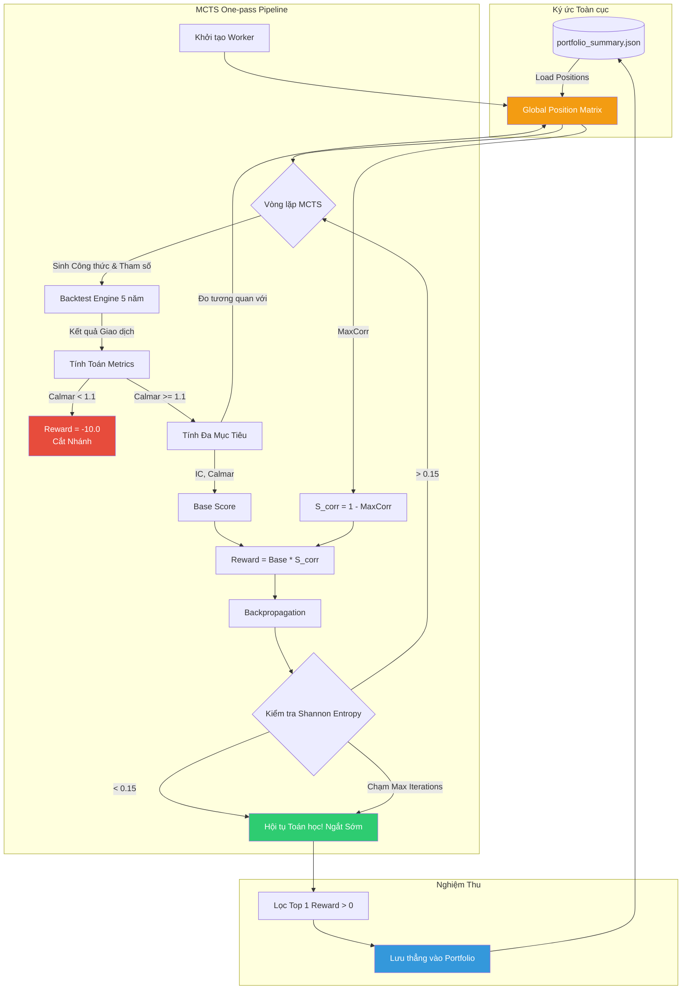

# alpha_farm

Hệ thống tự động sinh, tối ưu hóa và thử nghiệm **tín hiệu giao dịch có hướng** (Directional Trading Signals) cho thị trường phái sinh VN30F.

### Câu hỏi nghiên cứu

> *Có thể kết hợp LLM (sinh cấu trúc chiến lược) với MCTS (tối ưu tham số) để tự động hóa việc khám phá các tín hiệu giao dịch có hướng trên hợp đồng tương lai đơn tài sản không?*

### Bản chất tín hiệu được sinh ra

Hệ thống sinh ra **Systematic Directional Signals** — tín hiệu dự đoán hướng đi tuyệt đối (Long/Short/Flat) trên một instrument duy nhất (VN30F), tương tự mô hình CTA/Managed Futures. Đây **không phải** Cross-sectional Alpha theo nghĩa của WorldQuant BRAIN (xếp hạng tương đối giữa hàng nghìn cổ phiếu để tạo danh mục Market Neutral).

| | Hệ thống này (Directional Signal) | WorldQuant BRAIN (Cross-sectional Alpha) |
|:---|:---|:---|
| **Input** | 1 instrument (VN30F), 3 chuỗi data | 3000+ cổ phiếu, hàng trăm trường data |
| **Output** | Quyết định hướng: Long / Short / Flat | Điểm số tương đối cho từng cổ phiếu |
| **Rủi ro chính** | Directional risk (đoán sai hướng thị trường) | Relative risk (chọn sai cổ phiếu so với nhau) |
| **Bảo vệ regime** | Phụ thuộc vào cơ chế kích hoạt vị thế (z-score, threshold) | Market Neutral tự nhiên qua Long/Short cân bằng |
| **Giới hạn diversity** | Hữu hạn — tất cả tín hiệu đều từ cùng 1 chuỗi giá | Rất lớn — tổ hợp chéo giữa hàng nghìn tài sản |

## 1. Kiến trúc Hệ thống (Dual Engine with Self-Correction)

Hệ thống được thiết kế theo mô hình khép kín gồm 2 động cơ độc lập (LLM Engine và MCTS Engine), được điều khiển tập trung qua `main.py`:

```mermaid
graph TD
    run_all(main.py<br>CLI Orchestrator)

    subgraph LLM_Engine ["Tầng 1: LLM Blueprint Generation"]
        run_all -->|1. python main.py generate| pipeline(GenerateStrategies.py)
        pipeline -->|Dịch & Validate Cú pháp| semantic_val[SemanticCompiler]
        semantic_val -->|Lỗi Cú Pháp / Ảo Giác| self_correct[Agentic Self-Correction]
        self_correct -->|Cập nhật JSON| pipeline
        semantic_val -->|Hợp lệ| save_json[Lưu Blueprint JSON]
    end

    subgraph MCTS_Engine ["Tầng 2 & 3: MCTS Brute-force & Sandbox"]
        run_all -->|2. python main.py mcts| mcts(RunMCTS.py)
        save_json -->|Load Blueprints| mcts
        mcts -->|Check Dimensional Bleeding & Compile (Multi-template)| mcts_sandbox[PlatformEmulator]
        mcts_sandbox -->|Backtest 2020-2025 đạt chuẩn| hmm[HMM Regime Validation]
        hmm -->|Pass Stressed Scenarios| save_success[Lưu Code Python vào results/]
    end

    subgraph Web_Environment ["Tầng Nộp chiến lược lên Web"]
        auto_sub(SubmitStrategies.py)
        save_success -->|3. python main.py submit| auto_sub
        auto_sub -->|Playwright CDP| xno_web((Sàn XNOQuant))
        auto_sub -->|Thành công| pushed[Di chuyển vào pushed/]
    end

    style LLM_Engine stroke:#3498db,stroke-width:2px
    style MCTS_Engine stroke:#9b59b6,stroke-width:2px
    style Web_Environment stroke:#666,stroke-width:2px
    style Offline_Tuning stroke:#3498db,stroke-width:2px,stroke-dasharray: 5 5
    style xno_web fill:#28a745,color:#fff
    style pushed fill:#f39c12,color:#fff
    style optuna_tool fill:#2980b9,color:#fff
```

Để xem thông tin kỹ thuật chuyên sâu về cấu trúc hệ thống và quy định (Rules) của sân chơi XNOQuant, vui lòng tham khảo file `ARCH.md`.

---

## 2. Hướng dẫn cài đặt và sử dụng

### Yêu cầu hệ thống

- Python 3.12 (Quản lý môi trường bằng `uv` để build các package C++ như `hmmlearn` và `TA-Lib`).
- Đã cài đặt Chrome hoặc Edge (để chạy tiện ích Playwright).
- Ollama local.

### Cài đặt thư viện

Chạy lệnh sau để cài đặt toàn bộ các thư viện cần thiết:

```bash
uv pip install -r utilities/deps/deepseek4free/requirements.txt
uv pip install python-dotenv hmmlearn TA-Lib
```

### Cấu hình API & Tài khoản (.env)

Copy file `.env.example` thành `.env` và điền thông tin tài khoản XNOQuant:

```env
XNO_ACCOUNT=your_email@gmail.com
XNO_PASSWORD=your_password
```

- **Gemini**: Dán cookie lấy từ header vào file `cookies.txt` (nếu dùng mô hình Gemini).
- **DeepSeek**: Đăng nhập vào chat.deepseek.com, mở F12 (Network), sao chép giá trị của `Authorization` header và dán vào file `token.txt` ở thư mục gốc.

---

## 3. Khởi chạy hệ thống (CLI Commands)

Toàn bộ hệ thống nay được điều khiển thông qua một file duy nhất `main.py`. Bạn có thể sử dụng cờ `--help` để xem chi tiết:

```bash
python main.py --help
```

### Cách 1: Chạy Tự Động Toàn Tập (Nhạc Trưởng)

Dành cho việc cắm máy tự động chạy qua toàn bộ quy trình 3 Tầng: Sinh ý tưởng (Generate) $\rightarrow$ Tìm kiếm thông số MCTS (MCTS) $\rightarrow$ Auto Submit.

```bash
python main.py full --n_strategies 20 --model deepseek-thinking
```

### Cách 2: Chạy Từng Động Cơ Độc Lập

Bạn hoàn toàn có thể chạy riêng từng phần tùy theo nhu cầu để dễ dàng debug và kiểm soát:

- **Săn Alpha bằng MCTS (Không cần AI):** Tự động dò tìm công thức toán học và đánh giá.
  ```bash
  python main.py mcts
  ```
- **Sinh Ý Tưởng bằng LLM (Deepseek/Gemini):** Dùng AI viết kịch bản giao dịch dạng khung cấu trúc (Blueprint JSON).
  ```bash
  python main.py generate --n_strategies 20 --model deepseek-thinking
  ```
- **Tầng 2 & 3 (Compiler & MCTS):** Đọc các Blueprint JSON, biên dịch, tìm kiếm MCTS Brute-force để lắp thông số, đánh giá bằng Sandbox Sandbox và xuất ra file Code Python hoàn chỉnh.
  ```bash
  python main.py mcts
  ```

---

## 4. Tinh chỉnh Sức mạnh (Tuning & Optimization)

### Tự sửa lỗi Inline (Agentic Self-Correction)

Quá trình tự sửa lỗi hiện tại đã được tích hợp trực tiếp **(Inline)** vào Tầng 1 (`GenerateStrategies.py`).
Ngay khi LLM sinh ra một Blueprint bị sai cú pháp hoặc sai thứ nguyên, `SemanticCompiler` sẽ ném lỗi và bắt LLM (Local model) sửa ngay lập tức trong bộ nhớ mà không cần lưu ra file riêng lẻ. Bạn không cần phải chạy kịch bản sửa lỗi thủ công như kiến trúc cũ.

### MCTS Engine Tuning (`strategy_workflows/RunMCTS.py`)

MCTS thay thế hoàn toàn hệ thống Optuna cũ. MCTS Brute-force không chỉ tối ưu tham số mà còn tự động khám phá và xây dựng cây biểu thức toán học (AST).
Động cơ MCTS có khả năng tối ưu hóa tham số động (Dynamic Parameter Optimization):

- **Window Size & Z-Score Threshold**: Không còn bị gán cứng (hardcode), MCTS sẽ tự động tìm kiếm chu kỳ làm mượt (`window`) và ngưỡng kích hoạt tương thích nhất thông qua cơ chế **Scale-Mismatch Dynamic Tuning** dựa trên timeframe, giúp phá vỡ giới hạn "mù thời gian" của hệ thống cũ. Hệ thống tự động phân loại tín hiệu theo 3 template: **Boolean**, **Ratio**, và **Normalized**.
- **HMM Regime Validation (Hidden Markov Model)**: Sau khi tìm được tham số tốt nhất, MCTS chuyển chiến lược sang bộ lọc HMM. HMM sẽ dùng thuật toán Monte Carlo để mô phỏng (synthesize) hàng chục kịch bản giá ảo (Synthetic Paths) trong điều kiện bình thường và căng thẳng (Stressed Regime) từ ma trận chuyển trạng thái. Chỉ chiến lược nào sống sót qua cả thị trường thực tế và thị trường giả lập HMM mới được cấp phép.

Bạn có thể tinh chỉnh sức mạnh bằng cách cấu hình số vòng lặp:

- **`MCTS_ITERATIONS`**: Tăng số vòng lặp để đào sâu vào các nhánh tham số phức tạp.

---

## 5. Cấu hình Model & Context Caching

Hệ thống hỗ trợ tự động Cache (bộ nhớ đệm) cho các LLM chạy trên máy cục bộ (như vLLM, Ollama) giúp tốc độ sinh chiến lược cực kỳ nhanh.
Bạn có thể cấu hình chọn model trực tiếp qua tham số dòng lệnh:

```bash
# Chạy mô hình tư duy đám mây
python main.py generate --model deepseek-thinking

# Chạy mô hình tốc độ cao nội bộ (đã tối ưu Context Caching)
python main.py generate --model ollama-9b
```

---

## 6. Cơ chế chấm điểm và Hội tụ nội bộ của MCTS (One-pass Pipeline)



Động cơ MCTS Brute-force sử dụng kiến trúc **One-pass Pipeline** hợp nhất Tầng Khám phá và Tầng Nghiệm thu, với hệ thống chấm điểm đa mục tiêu và hội tụ thông minh:

**`Reward = (0.6 * S_calmar + 0.4 * S_ic) * S_corr`**

**Giải thích các thành phần:**
- **Máy chém Calmar (Hard Filter)**: Bất kỳ công thức nào có `Calmar < 1.1` sẽ lập tức bị gán Reward = -10.0 để MCTS cắt bỏ nhánh đó. `S_calmar` là hệ số Calmar được chuẩn hóa Min-Max (ngưỡng tối đa 3.0).
- **`S_ic`**: Hệ số Rank IC đo lường khả năng tiên tri hướng đi của thị trường, chuẩn hóa Min-Max (ngưỡng tối đa 0.15).
- **`S_corr` (Global Correlation Penalty)**: MCTS được truyền một Ma trận Vị thế Lịch sử (Ký ức toàn cục). `S_corr = 1.0 - MaxCorr`. Nếu công thức sinh ra đạo nhái hoàn toàn một chiến lược đã có, `MaxCorr = 1.0` $\rightarrow$ Reward = 0, ép cây UCT phải rẽ sang hướng khác!

**Hội tụ sớm (Early Stopping):**
Hệ thống sử dụng hai cơ chế ngắt vòng lặp sớm để tiết kiệm tài nguyên:
1. **Shannon Entropy**: Theo dõi mức độ phân tán của Nút Gốc. Khi Entropy giảm xuống dưới ngưỡng `0.15` (thuật toán không còn "phân vân"), MCTS sẽ tự động ngắt.
2. **Patience (Kiên nhẫn)**: Nếu điểm số (Reward) tốt nhất không có sự cải thiện trong suốt một số lượng vòng lặp nhất định (mặc định 5000 vòng), hệ thống sẽ chủ động kết thúc quá trình tìm kiếm.

**Đặc biệt - Risk-Seeking UCT Optimization:**
Khi duyệt cây tìm kiếm (UCT), MCTS không sử dụng điểm trung bình (Mean Reward) mà sử dụng **Điểm lớn nhất (Max Reward)**. Đây là kỹ thuật "Tail Quantile Optimization", chấp nhận sự không ổn định để tìm ra những chuỗi tham số "đột biến" mang lại hiệu suất cao nhất.

**Cơ chế Lan truyền ngược (Backpropagation Formula):**
Trong pha Lan truyền ngược, hệ thống cập nhật giá trị cho các nút dọc theo đường đi ($v \in \text{path}$) của phiên chạy thử nghiệm thứ $i$ dựa trên phần thưởng thu được $R$:
* Cập nhật số lượt ghé thăm (visit count):
  $$\text{visit\_count}_v \leftarrow \text{visit\_count}_v + 1$$
* Cập nhật giá trị phần thưởng lớn nhất của nút:
  $$\text{max\_reward}_v \leftarrow \max(\text{max\_reward}_v, R)$$

Cơ chế này giúp giữ lại dấu vết của các công thức "đột biến" (outliers) có hiệu năng vượt trội trong mỗi nhánh tìm kiếm, hướng thuật toán tập trung đào sâu vào các vùng không gian chiến lược chứa Alpha chất lượng cao. Các nhánh công thức vô dụng sẽ bị loại bỏ thông qua cơ chế cấm tự động (FSA Forbidden Patterns / Linear Amnesia Mitigation).

---

## 7. Động Cơ Lõi Vectorized & Chống Rò Rỉ Dữ Liệu (Core Engine)

Hệ thống sở hữu một động cơ giả lập siêu tốc (`XNOBacktestEngine`) được thiết kế đặc trị chuẩn mực cho thị trường Phái sinh VN30F:

- **Vectorized O(1) Execution:** Loại bỏ hoàn toàn vòng lặp Python, sử dụng ma trận Numpy để tính toán trạng thái lệnh và Mark-to-Market PnL tức thời.
- **VN30F Netting Fee:** Phí giao dịch được trừ chính xác dựa trên Delta hợp đồng (chênh lệch vị thế), cứu vớt các chiến lược DCA/Scale-in khỏi hiện tượng Commission Drag do thuật toán Full Close/Reopen sai lầm của Crypto.
- **Lookahead Bias Prevention:** Engine tự động `shift(1)` toàn bộ tín hiệu. Lệnh sinh ra ở nến hiện tại sẽ tự động dời điểm khớp lệnh sang nến tiếp theo, chặn đứng 100% rủi ro MCTS tìm ra "Chén thánh giả" ăn gian dữ liệu tương lai.
- **Constant Returns Metrics:** Các chỉ số rủi ro (Volatility, Sortino, VaR) trong `CalculateMetrics.py` được đo lường bằng lợi nhuận theo vốn cố định (`constant_returns`), phản ánh thực tế giao dịch khối lượng hợp đồng cố định.

---

## 8. So Sánh Backtest và Vận Hành Thực Tế (Phái Sinh Việt Nam & WorldQuant)

Do tính chất đơn giản hóa của quá trình giả lập và kiểm thử, kết quả backtest của hệ thống và vận hành thực tế luôn có những điểm sai lệch. Dưới đây là các phân tích chi tiết:

### 8.1. So sánh chi tiết với Thị trường Phái sinh Việt Nam (VN30F1M) thực tế

| Đặc tính phái sinh thực tế | Mức độ giả lập của [XNOBacktestEngine](file:///f:/Projects/alpha_farm/core_engine/BacktestEngine.py#L110) | Giới hạn & Điều kiện biên |
| :--- | :--- | :--- |
| **Ký quỹ ban đầu (IM) & Đòn bẩy** | **Có hỗ trợ một phần** | Sử dụng tỷ lệ cố định `MARGIN_RATE = 28.5%` tại [AppConfig.py](file:///f:/Projects/alpha_farm/utilities/AppConfig.py#L51). Thực tế tỷ lệ này có thể được điều chỉnh linh hoạt bởi VSD/Công ty chứng khoán ($17\% - 24\%$). Không mô phỏng ký quỹ duy trì (Maintenance Margin) và cuộc gọi ký quỹ (Margin Call). |
| **Hạch toán lãi/lỗ (MTM & Settlement)** | **Gần đúng (Bar-by-bar)** | Lãi lỗ được cộng dồn trực tiếp vào `equity` tại mỗi nến (1m, 10m...) thay vì tách biệt "Số dư tiền mặt" và "Lãi/lỗ danh nghĩa chưa thực hiện" hạch toán cuối ngày như VSD. Giao dịch T+0 được hỗ trợ đầy đủ. |
| **Ngày đáo hạn & Chốt giá chỉ số VN30** | **Không hỗ trợ** | Backtest sử dụng chuỗi dữ liệu nối liền (Continuous/Rolled Futures Data). Hệ thống giả định hợp đồng không bao giờ hết hạn, do đó không có cơ chế cưỡng bức đóng vị thế (Force Settle) vào ngày Thứ Năm lần thứ 3 của tháng và không đổi giá tính PnL sang chỉ số cơ sở VN30 (`pv_vn30_close`). |
| **Trượt giá (Slippage) & Độ trễ (Latency)** | **Chưa mô phỏng** | Giả định khớp lệnh 100% tại giá Close của nến kế tiếp. Thực tế giao dịch số lượng hợp đồng lớn sẽ bị ảnh hưởng bởi thanh khoản sổ lệnh (Market Impact) và độ trễ truyền nhận lệnh của API công ty chứng khoán. |

### 8.2. So sánh với triết lý quản lý lệnh của WorldQuant (WebSim/BRAIN)

* **Số lượng tài sản (Universe):** 
  * *WorldQuant:* Quản lý danh mục đa tài sản (hàng nghìn cổ phiếu), tạo ra vector trọng số tương đối (Relative Weights) giữa các mã.
  * *XNOQuant:* Giao dịch đơn tài sản (VN30F1M), tạo ra tín hiệu hướng tuyệt đối (Long/Short/Cash) tương ứng với giá trị vị thế `[1.0, -1.0, 0.0]`.
* **Trung hòa danh mục (Neutralization):**
  * *WorldQuant:* Bắt buộc áp dụng cơ chế Dollar Neutral (Long = Short) và Sector/Industry Neutral. Danh mục luôn được giải ngân đầy đủ (Fully Invested).
  * *XNOQuant:* Giao dịch định hướng (Directional/Beta), không trung hòa và cho phép rút toàn bộ $100\%$ về tiền mặt.
* **Tái cơ cấu danh mục (Rebalancing):**
  * *WorldQuant:* Điều chỉnh tỷ trọng (Rebalance) định kỳ (thường là Daily).
  * *XNOQuant:* Kích hoạt giao dịch ngay lập tức (Intraday) dựa trên ngưỡng biên độ kỹ thuật (Z-Score) tại từng cây nến cụ thể.

---

## 9. Kế hoạch Nâng cấp & Hoàn thiện (Thesis Roadmap)

Để giải quyết các rủi ro thống kê và kỹ thuật hiện tại, hệ thống định hướng hai nâng cấp cốt lõi phục vụ đề tài nghiên cứu:

### 9.1. Tích hợp kiểm định DSR (Deflated Sharpe Ratio)
*   **Vấn đề:** MCTS chạy hàng nghìn vòng lặp ($K$) dễ dẫn đến hiện tượng ăn may lịch sử (Multiple Testing Bias / Overfitting).
*   **Giải pháp:** Áp dụng công thức DSR dựa trên số lần thử $K$, độ dài dữ liệu $T$, Skewness, Kurtosis và độ lệch chuẩn của các Sharpe đã test. Chỉ chấp nhận các Alpha có $DSR \ge 0.85$.

### 9.2. Phân rã Template kích hoạt vị thế theo Kiểu dữ liệu (Multi-template)
*   **Vấn đề:** Ép tất cả đầu ra (Boolean, RSI, Giá, Volume) qua Z-score gây méo tín hiệu (tạo độ trễ, tự triệt tiêu xu hướng khi tín hiệu xuất hiện liên tục, và khuếch đại nhiễu khi đi ngang).
*   **Giải pháp:** Chia làm 3 template xử lý vị thế riêng biệt dựa trên Output Dimension:
    1.  **Boolean Template:** Kích hoạt vị thế trực tiếp bằng True/False mask (cho nến búa, giao cắt).
    2.  **Ratio Template:** Giao dịch theo ngưỡng tĩnh tuyệt đối (như RSI > 70 hoặc < 30).
    3.  **Normalized Template (Z-score):** Chỉ dùng Z-score để chuẩn hóa các chuỗi không giới hạn (như Giá, Volume).


